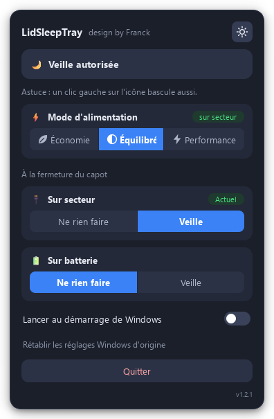
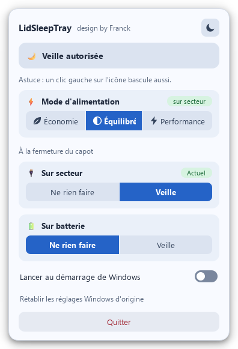

# LidSleepTray

[](https://github.com/francknos/LidSleepTray/actions/workflows/build.yml)
[](LICENSE)


[](https://github.com/francknos/LidSleepTray/releases)

Petite icône dans la zone de notification Windows (Qt 6) pour :

- **Clic gauche** : bloquer / autoriser la mise en veille automatique (☀️ / 🌙).
  Cet état est mémorisé séparément **sur secteur** et **sur batterie**, puis rétabli
  automatiquement lors d'un changement d'alimentation et au prochain lancement.
  Par défaut, la veille reste autorisée pour chaque alimentation.
- **Clic droit** : ouvrir un petit panneau pour choisir l'action à la **fermeture du capot**
  (*Ne rien faire* ou *Veille*), séparément **sur secteur** et **sur batterie**.
  Les choix sont mémorisés et l'application bascule d'une configuration à l'autre
  quand l'ordinateur passe du secteur à la batterie (et inversement).
- Option **Lancer au démarrage de Windows**.
- Icône soleil / lune dans le panneau pour choisir un thème clair ou sombre. Le choix
  est mémorisé pour les prochains lancements ; le thème sombre est utilisé par défaut.
- Bouton pour **rétablir les réglages Windows d'origine** (sauvegardés au premier lancement).

## Aperçu

| Thème sombre | Thème clair |
|:--:|:--:|
|  |  |

Pas de droits administrateur nécessaires : l'app modifie le plan d'alimentation de l'utilisateur
via l'API `PowerWriteACValueIndex` / `PowerWriteDCValueIndex` (réglage *Lid close action*).

## Installation
Télécharger `LidSleepTray-win64.zip` dans les *Releases* (ou l'artefact de la dernière CI), décompresser, lancer `LidSleepTray.exe`.

## Mises à jour
Au démarrage, LidSleepTray vérifie en arrière-plan les versions stables publiées sur GitHub.
Si une version plus récente est disponible, tu peux choisir **Plus tard** ou **Télécharger et installer**.
Dans ce dernier cas, l'application vérifie l'empreinte SHA-256 du fichier avant de lancer
l'installateur Windows. Si tu utilises la version ZIP, l'installateur ne remplace pas
les fichiers du dossier portable : pour rester en mode portable, récupère plutôt le nouveau ZIP.

## Compiler
```
cmake -B build -G Ninja -DCMAKE_BUILD_TYPE=Release
cmake --build build
```
Prérequis : Qt 6 (Widgets et Network), CMake ≥ 3.21, MSVC.

Pour compiler et exécuter les tests :
```
cmake -B build -G Ninja -DCMAKE_BUILD_TYPE=Release -DLIDSLEEPTRAY_BUILD_TESTS=ON
cmake --build build
ctest --test-dir build --output-on-failure
```
Pour régénérer les captures du README : `build\SettingsPopupTest.exe --capture-screenshots docs\screenshots`.
Pour régénérer l'icône Windows : `python assets\make_app_icon.py`.

## Notes
- La bascule "veille bloquée" utilise `SetThreadExecutionState` (`ES_SYSTEM_REQUIRED` + `ES_DISPLAY_REQUIRED`) : elle empêche la veille automatique **et garde l'écran allumé**, elle ne change pas l'action du capot (c'est le rôle du panneau).
- Certains PC gérés par stratégie de groupe interdisent la modification du plan d'alimentation.

Licence MIT.
